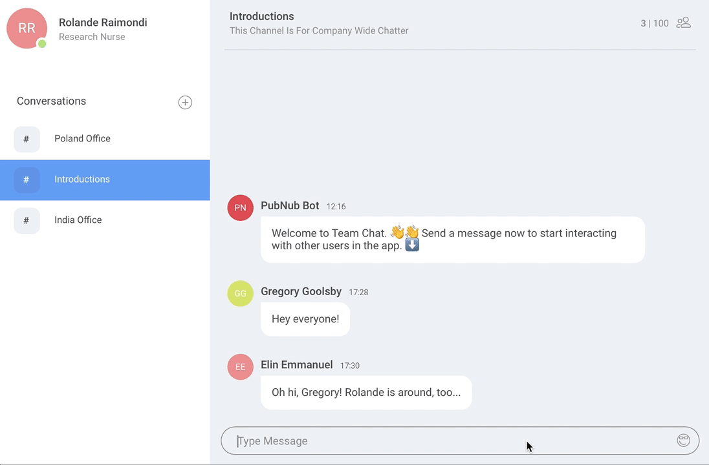

# React Chat Application

A single-page real-time chat application built with React, Vite, Tailwind CSS, and an Express + Socket.IO server.



---

## Quick Start

### 1. Install dependencies
```bash
npm run install:all
```

### 2. Run client and server concurrently
```bash
npm start
```
- Client: `http://localhost:5173`
- Socket.IO Server: `http://localhost:3001`

### 3. Run client only (offline mode)
```bash
npm run client
```

---

## Features

- **Chat Thread**: Single-page message feed with timestamps, avatar initials, and color coding per user.
- **Random Author Assignment**: Each sent message randomly selects an author from `["Alan", "Bob", "Carol", "Dean", "Elin"]`.
- **Like Counter**: A like button at the right of each message that increments and syncs across clients.
- **Emoji Picker (Stretch 1)**: In-app grid of ~40 emojis. Inserts at caret position, allows picking multiple emojis before dismissal, and closes on Escape or click outside.
- **@ Mentions (Stretch 2)**: Triggers by typing `@` or clicking the `@` button. Filters members dynamically, supports keyboard navigation (`ArrowUp`/`ArrowDown`/`Enter`/`Tab`/`Escape`), and safely renders mentions as pill badges without `dangerouslySetInnerHTML`.
- **Real-Time WebSockets (Stretch 3)**: Express + Socket.IO backend supporting message broadcasts (`send_message`/`new_message`), live likes (`like_message`/`message_liked`), active presence tracking (`presence`), and message history on connection.
- **Large Emoji-Only Messages**: Messages containing only emojis are displayed in a larger size.
- **Theme Toggle**: Light/Dark mode toggle in the header with OS preference detection and `localStorage` persistence.
- **Smart Auto-Scroll**: Scrolls to bottom on new messages if the user is already near the bottom; displays a "New messages below" button if scrolled up.
- **Offline Fallback**: Operates in-memory locally if the backend server is unreachable.
- **Echo Deduplication**: Unique message IDs prevent duplicate renders from socket echoes.

---

## Design Decisions & Behavior Notes

1. **Architecture**: Monorepo with `client/` (React, Vite, Tailwind CSS) and `server/` (Node.js, Express, Socket.IO). Concurrently manages dev execution from root scripts.
2. **Safe Mentions Rendering**: Message text is tokenized into safe React elements rather than raw HTML strings to avoid XSS risks.
3. **Caret-Aware Insertion**: Both mentions and emojis calculate caret offsets to insert at the cursor position and retain textarea focus.
4. **Empty State**: Initial message list is empty; displays a prompt until the first message is sent.
5. **Accessibility**: Includes `role="log"` and `aria-live="polite"` on message threads, keyboard navigation for menus, and `aria-label` attributes on buttons.

---

## Available Scripts

| Command | Action |
| :--- | :--- |
| `npm run install:all` | Installs root, server, and client dependencies |
| `npm start` | Runs server (`:3001`) and client (`:5173`) together |
| `npm run client` | Starts Vite client only |
| `npm run server` | Starts Socket.IO backend server only |
| `npm run build` | Builds client for production |
